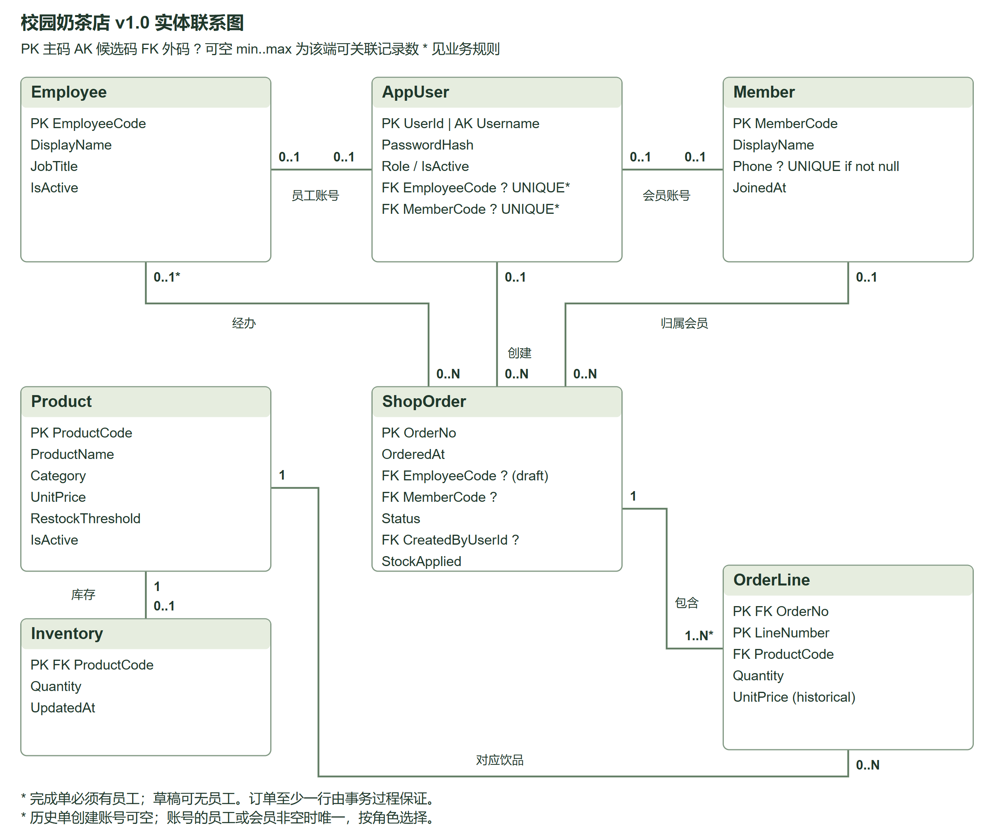

# 校园奶茶店数据库应用 v1.0

第二阶段覆盖第五周ER模型、第六周规范化与数据迁移、第七至九周Web应用。小组成员：袁远冬、陆乐天、罗金浩。第一阶段根目录材料和原库保持保留；本阶段成果全部位于 stage2。

先阅读最新 [课程复核版报告 Word](阶段报告_课程复核版.docx) 或 [PDF](阶段报告_课程复核版.pdf)，详细操作见 [操作手册](docs/user-manual.md)。

## 环境与空环境复现

已实测 Windows、Python 3.14、SQL Server 2025 Express 17.0.1000.7、ODBC Driver 18、Flask 3.1.2、pyodbc 5.3.0、Microsoft Edge。Python 3.11及以上可作为安装候选，其余版本未逐一实测。SQL Server须启动；初始化使用有建库/还原/授权权限的Windows账户。

在仓库根目录（含第一阶段 sql 和 stage2 的目录）运行：

```powershell
python -m venv .venv
.\.venv\Scripts\python.exe -m pip install -r stage2/requirements-dev.txt
# 空环境：从随包的第一阶段脚本创建独立基线，然后真正执行迁移
.\.venv\Scripts\python.exe -m stage2.tools.setup --from-scripts --database MilkTeaShopV10_Demo
# 已有第一阶段库：去掉 --from-scripts，默认备份并还原 MilkTeaShopV01 的副本
# 目标库或 stage2/.env 已存在时拒绝覆盖，重新实验请选新数据库名及 --env-file
.\.venv\Scripts\python.exe -m stage2
```

访问 http://127.0.0.1:5000，或双击仓库根目录“启动第二阶段.bat”。默认仅监听本机；Flask开发服务用于课堂演示，不作为公网部署方案。端口被占用可先 `$env:PORT='5010'` 再启动。ODBC18的本机实验连接信任服务器证书。

账号 admin（管理员）、clerk（店员）、customer（会员顾客）、guest（散客顾客）。随机密码保存在 `stage2/private/<数据库名>_accounts.json`，只在本机读取；Web密码是哈希存储。四个数据库应用角色密码和会话密钥在 stage2/.env，不提交到GitHub或提交包。其他同学运行setup会生成自己的凭据，无需索取原机密码。

本次演示库为 MilkTeaShopV10_Final。此前调试副本保留供追溯；不会自动删除任何数据库。服务器认证模式、服务启动状态不由初始化脚本改变。

## 使用与权限

| 功能 | 顾客 | 店员 | 管理员 |
| --- | --- | --- | --- |
| 登录、菜单/库存查询 | 允许 | 允许 | 允许 |
| 草稿和明细新增、查询、修改、删行、删除 | 仅自己的 | 全部 | 全部 |
| 草稿确认并扣库存 | 不允许，交由店员核对 | 允许 | 允许 |
| 草稿取消 | 仅自己的 | 允许 | 允许 |
| v1.0完成单取消并恢复库存 | 不允许 | 允许 | 允许 |
| 历史v0.1完成单取消 | 不允许 | 不允许 | 不允许 |
| 商品增改删/上下架、库存盘点/登记/删除零库存 | 不允许 | 不允许 | 允许 |
| 销售统计 | 不允许 | 允许 | 允许 |

完成单明细不能任意改写；取消保留历史；订单总额从明细计算。允许同一商品多行，确认时按商品汇总扣减。库存不足时此前已执行的扣减也全部回滚。

## 结构与交付对应

```text
stage2/
  web/templates/  页面结构
  web/static/     页面交互与样式，fetch调用API
  web/app.py      Flask请求处理及统一错误与日志
  web/service.py  业务校验、角色/所有权、流程组织
  web/dao.py      唯一运行时SQL入口、连接/绑定/提交/回滚/释放
  sql/           migration.sql / application.sql / regression.sql / normalization_demo.sql
  tools/         隔离初始化、浏览器验收、结果与图生成
  tests/         真实SQL Server集成测试
  docs/          ER源图与PNG、字典、依赖/范式/规则、迁移说明、手册、ai_log、分工
  result/        回归输出、测试结果、迁移前后对照、浏览器截图、复现记录
```

ER图可编辑源文件为 docs/er-v01.svg、er-v10.svg，PNG为清晰导出图。SVG是矢量源图，可用Inkscape或矢量编辑器修改实体框、连线与文本；图采用统一的PK/AK/FK和min..max关系标注。完整分析见 [设计说明](docs/design.md)，[字段字典](docs/data-dictionary.md)，[迁移说明](docs/migration-guide.md)，[逐周要求对照](docs/requirements-mapping.md)。

## 设计概要



原有六张表保留，新增AppUser账号与订单来源状态。ProductCode、MemberCode、EmployeeCode、OrderNo分别标识商品、会员、员工、订单；OrderLine以(OrderNo,LineNumber)联合标识，允许同一饮品多行；Username也是账号候选码。图上联系均标明名称、最小/最大基数与条件参与。

六张原表在已声明的业务函数依赖下符合BCNF：单表非平凡依赖的决定因素均为超码，明细的商品、数量和成交价依赖完整联合码，不复制其他实体的名称。类别仅有原子名称，实际库不做没有依据的拆表；独立演示关系展示类别编号决定类别名称产生的三类更新异常及无损、依赖保持分解。当前菜单价与历史成交价表达不同事实，应分别保留。完整逐表证明见design.md。

功能输入、处理、输出及两条分层调用路径见 [接口与分层说明](docs/api-and-layering.md)。结果目录的 [证据入口](result/README.md) 集中列出ER、规范化、迁移、权限和Web流程证据；[课程复核结论](docs/course-review.md) 记录第二次独立核查发现的问题、修订和范围限制。

## 重新验收

```powershell
# 首次创建独立测试库，名称以_Test结尾，避免误测演示库
.\.venv\Scripts\python.exe -m stage2.tools.setup --from-scripts --database MilkTeaShopV10_Your_Test --env-file stage2/private/test.env --result-dir stage2/result/replay
sqlcmd -S '.\SQLEXPRESS' -d MilkTeaShopV10_Your_Test -E -C -b -f 65001 -i stage2/sql/regression.sql -o stage2/result/regression-replay.txt
.\.venv\Scripts\python.exe -m pytest stage2/tests -q --junitxml=stage2/result/pytest.xml
.\.venv\Scripts\python.exe -m stage2.tools.browser_acceptance
```

浏览器验收使用本机已安装Edge，自动启动5001端口测试服务；无需安装Playwright浏览器。自动化测试只对private/test.env指定的独立测试库执行清理，会移除WEB测试订单并恢复测试数据；不要将日常业务库命名为_Test。每次浏览器验收前先运行pytest恢复基线。最后再运行pytest可清理浏览器写入的测试流水。

本次结果以 result/pytest.xml、browser-acceptance.json 和 regression.txt 为准。SQL回归13项；API/数据库及跨功能集成43例；真实浏览器18项流程，含真实连接失败、12张截图。40001事务错误分类测试明确采用故障注入；SQL库存回滚和并发检查使用真实数据库。复现、报告及最终包验证结果另见result中的对应文件。

代码不向前端泄露SQL、连接串、路径或堆栈；响应统一为 ok/code/message/data/request_id。后端 JSONL 日志在 logs/，含请求编号、UTC时间、操作、角色、错误码和结果；详细诊断日志仅留本机，不带请求密码，提交证据只导出脱敏字段。
